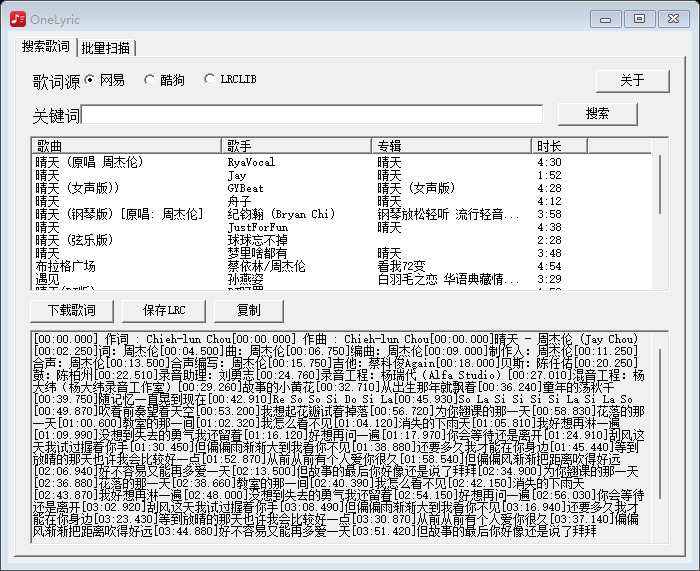
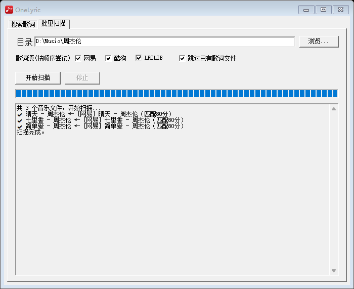
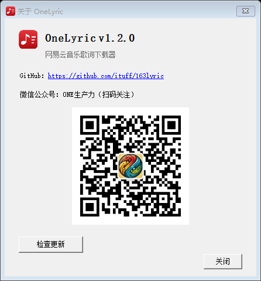

<p align="center"></p>

# OneLyric

网易云音乐歌词下载器：**三源搜索 · 批量扫描 · 一键更新**。

输入歌名、歌手或专辑即可从网易、酷狗、LRCLIB 三个歌词源搜索并下载 LRC 歌词；也可以选定音乐目录批量扫描，自动为每首歌匹配并保存与歌曲同名的 `.lrc` 文件。（原名 163lyric，v1.2 起更名为 OneLyric。）

## 功能

### 搜索歌词

选择歌词源（网易 / 酷狗 / LRCLIB），输入歌名、歌手、专辑的任意组合关键词，搜索后在结果列表中双击（或选中后点"下载歌词"）即可预览歌词，再"保存LRC"或"复制"。



### 批量扫描

选择音乐目录，按顺序勾选歌词源（从上到下依次尝试），点"开始扫描"。工具会：

1. 读取每个音乐文件的内嵌标签（歌名/歌手/专辑/时长），标签缺失时按文件名 `歌手 - 歌名` 兜底解析；
2. 到各歌词源搜索并用标题、歌手、时长打分匹配；
3. 匹配可信（标题一致，且歌手或时长也对得上）才保存，可疑的跳过并写进日志；
4. 歌词保存为与歌曲**同名**的 `.lrc` 文件（UTF-8 带 BOM），就在歌曲旁边。

支持 mp3 / flac / m4a / aac / ogg / opus / wma / wav / ape。可勾选"跳过已有歌词文件"做增量补齐。



### 关于与更新

主界面右上角"关于"按钮：查看当前版本与 GitHub 项目主页链接，以及作者公众号"ONE生产力"的二维码。点击"检查更新"会访问 GitHub Releases 对比最新版本，发现新版本时一键下载并自动完成替换与重启。



### 歌词源说明

| 歌词源 | 特点 | 翻译歌词 |
|---|---|---|
| 网易 | 中文歌最全，直接搜索 | 有（自动按时间轴合并进原文行下方，与官方客户端显示一致） |
| 酷狗 | 中文歌覆盖广，接口稳定 | 无 |
| LRCLIB | 开源歌词库（lrclib.net），外文歌推荐，免登录 | 无 |

## 下载地址

最新版本：https://github.com/ituff/163lyric/releases

源代码：https://github.com/ituff/163lyric

## 构建方法

安装任意较新的 .NET SDK（6.0+）后，在仓库根目录执行：

```
dotnet build 163lyric/163lyric -c Release
```

产物在 `163lyric/163lyric/bin/Release/net48/OneLyric.exe`。

注意：该工具需要 .NET Framework 4.8 支持（Windows 10 1903 及以上 / Windows 11 系统自带）。
